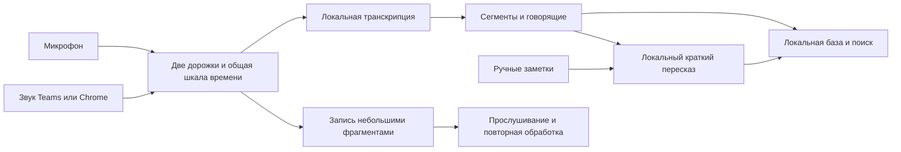

# Исследование: локальная альтернатива Granola

Дата: 2026-10-27, Asia/Tbilisi. Это проектное предложение, а не отчёт о работающем приложении. Сведения о внешних продуктах проверены по документации; производительность на целевом устройстве ещё не измерена.

## 1. Вывод

Нужный персональный сценарий реалистичен. Захватывать обе стороны разговора на Mac позволяют публичные API; локальные движки распознавания и генерации текста доступны. Основная сложность — обеспечить надёжность записи и границ встречи, а также качество русского, смешанной речи и разделения говорящих.

Нельзя обещать безусловное автоматическое обнаружение каждого звонка на любом сайте. ОС показывает использование аудио, но это не равно семантическому событию «встреча началась». Ручной старт и явный статус записи обязательны даже при наличии автоматики.

Проверено локально: MacBook Pro, Apple M4 Pro, 48 GB RAM, macOS 26.6.2. Это подходящая конфигурация для испытаний локальных моделей; точные скорость, нагрев и нагрузка во время Teams ещё неизвестны. В рабочей папке не обнаружено существующих Markdown-документов проекта.

## 2. Что воспроизводим

| Функция | Персональный MVP | Что важно |
|---|---|---|
| Teams desktop и звонки в Chrome | Да | Обе стороны, без участника-бота |
| Предложение начать запись | Да | Одно предложение на обнаруженную сессию |
| Автоматическая запись | Да, настройка | По приложениям; возможность исключений |
| Ручной старт, пауза, продолжение, стоп | Да | Работают при ошибках детектора |
| Сохранение и прослушивание аудио | Да, предлагаемое расширение | Пользователь явно просил запись; хранение настраивается |
| Полная транскрипция | Да | RU, EN, смешанная речь; таймкоды |
| Черновая транскрипция во время звонка | Да, с измеряемой задержкой | Финальное уточнение после завершения |
| Разделение голосов | Да, ступенчато | Сначала локальная/удалённая дорожка, затем говорящие |
| Краткий пересказ и расширенные заметки | Да | На основании текста и ручных заметок |
| Редактирование | Да | Название, ручные заметки, итог, исправления транскрипта |
| Папки, поиск, перенос, удаление | Да | Корзина, восстановление, экспорт |
| Шаблоны | Да, базовые | Общий, рабочая встреча, личная беседа |
| Календарь Google/Outlook | После основного MVP | Для заголовков и контекста; не условие записи |
| Вопросы по встрече/папке | Следующий этап | Цитируемые ответы, затем поиск по архиву |
| Импорт архива Granola | Отдельная задача | Только доступные экспорты; не часть захвата |
| Белорусский, Windows | Следующий этап | Отдельные языковые и платформенные тесты |
| Совместные папки, облачная синхронизация, CRM | Вне текущего scope | Для персональной версии не нужны |
| Видео и запись экрана | Вне MVP | Здесь «запись звонка» трактуется как аудио |

Это паритет нужного личного сценария, а не копирование всех функций актуальной Granola. Её справка описывает также календарь, папки, шаблоны и Chat. [Granola 101](https://docs.granola.ai/help-center/getting-started/granola-101)

## 3. Что выяснилось о Granola

Granola локально получает звук, но обрабатывает его в облаке; постоянную аудиозапись не оставляет. Поэтому наше сохранение аудио и полностью локальные модели — отдельные решения, а не буквальное воспроизведение её архитектуры. [Архитектура Granola](https://www.granola.ai/blog/local-first-ai-notetaker-vs-cloud)

Для незапланированных звонков она использует сигнал занятого микрофона. Всплывающие приглашения — собственные окна приложения, а не системные уведомления macOS. Это объясняет наблюдаемое пользователем поведение и даёт ориентир для UX. [Notifications](https://docs.granola.ai/help-center/taking-notes/notifications)

Справка прямо отмечает, что захват системного звука может включать постороннее аудио, а две встречи подряд могут слиться, если приложение не освобождает микрофон. Не следует обещать лучшую надёжность нашей версии до испытаний. [Transcription](https://docs.granola.ai/help-center/taking-notes/transcription)

Имена говорящих — дополнительный слой. Для Teams Granola использует сведения об участниках и активном спикере через Accessibility; для Meet есть Accessibility в Chrome или расширение. Сам аудиосигнал имён не содержит. [Teams](https://docs.granola.ai/help-center/taking-notes/speaker-attribution-teams), [Google Meet](https://docs.granola.ai/help-center/taking-notes/speaker-attribution-google-meet)

Генерация заметок использует транскрипт, введённые человеком заметки и календарный контекст; результат можно редактировать и пересоздавать. В нашем приложении ручной текст должен сохраняться независимо от AI-версий. [AI-enhanced notes](https://docs.granola.ai/help-center/taking-notes/ai-enhanced-notes)

## 4. Писать с нуля или использовать существующий проект

| Основа | Что подтверждено в источниках | Решение для нас |
|---|---|---|
| Meetily Community | MIT, Tauri/Rust, локальные модели, запись и заметки; Pro — отдельная база с дополнительными функциями | Кандидат для короткой проверки, не считать автодетекцию и диаризацию доступными в Community по общему описанию продукта |
| Anarlog, ранее Hyprnote | Открытая community-часть, локальный meeting workflow, React/Rust/Tauri; смешанная лицензия монорепозитория | Проверить сборку и конкретные модули; enterprise-код не считать MIT |
| Собственное Mac-приложение | Полный контроль над UX и аудио | Предпочтительный резервный путь при тяжёлой или неподходящей готовой основе |

Источники: [Meetily README](https://github.com/Zackriya-Solutions/meetily), [граница Community/Pro](https://meetily.ai/downloads), [Anarlog](https://github.com/fastrepl/anarlog), [лицензирование Anarlog](https://github.com/fastrepl/anarlog/blob/main/LICENSING.md).

Предлагаю ограничить оценку reuse двумя рабочими днями. Критерии: независимая локальная сборка, отсутствие обязательного аккаунта/облака, доступ к двум исходным аудиодорожкам, заменяемая RU/EN-модель, понятная схема данных, достаточная лицензия конкретных файлов. Если хотя бы ключевые аудио- и offline-требования требуют глубокой переделки, строить небольшую собственную основу. На текущем этапе исходники этих проектов не аудированы и приложения не установлены.

## 5. Захват звука на macOS

Основной кандидат — Core Audio Process Taps для удалённого звука плюс отдельный захват выбранного микрофона. Apple документирует taps для процесса или группы процессов, начиная с macOS 14.2, и разрешение через `NSAudioCaptureUsageDescription`. [Официальный пример Apple](https://developer.apple.com/documentation/coreaudio/capturing-system-audio-with-core-audio-taps)

Предлагаемый minimum deployment target собственного MVP — macOS 15, с реальной приёмкой на текущей macOS 26.6.2. Это наш выбор объёма поддержки, не минимальное требование Core Audio. Более старые версии не объявлять поддержанными без тестов.

Альтернатива для сравнения — ScreenCaptureKit: Apple показывает отдельный микрофонный выход вместе с системным аудио. Проверить сложность разрешений и поведение в фоне; не сохранять видеокадры только потому, что framework умеет видео. Не реализовывать два backend сразу, если первый проходит матрицу. [Apple WWDC24](https://developer.apple.com/videos/play/wwdc2024/10088/)

Предлагаемая цепочка:

Требования к реализации:

- Сохранять микрофон и удалённый звук отдельно. Не уничтожать происхождение речи ранним сведением в mono.
- Выбранный микрофон должен совпадать с микрофоном звонка; глобальный default не всегда совпадает с настройкой Teams.
- Tap не должен заглушать или перенаправлять слышимый пользователем звук. Собственный playback исключать из записи.
- Учитывать helper-процессы Teams и Chrome, пересоздание процессов, смену Bluetooth/USB-устройств и частоты дискретизации.
- Писать фрагменты с монотонными timestamps, счётчиками кадров и manifest; после crash восстанавливать уже завершённые фрагменты.
- В real-time callback — только короткая передача в bounded buffer. Диск, БД и ML работают вне него.
- Если ML не успевает, сохранять аудио и накапливать очередь; никогда не терять звук ради свежего текста.
- Отображать отдельно «идёт запись», «поступает звук», «идёт распознавание». Тишина не всегда ошибка, ненулевой поток не всегда речь.

Захват конкретного процесса помогает не включать музыку из другого приложения. Но **процесс Chrome не равен вкладке Chrome**: разные вкладки могут использовать общие аудиопроцессы. Пер-вкладочный захват и определение URL не гарантируются Core Audio. Для неизвестного сайта достаточен ручной старт с Chrome или системным mix; изоляция вкладки — отдельное исследование.

Публичные API и текущая ОС не гарантируют отсутствие ошибок разрешений. Прототип должен быть настоящим `.app` со стабильным bundle ID и понятной подписью. Проверить TCC на сборке, предназначенной для использования; не обходить разрешения. Для личной поставки не нужен App Store; Developer ID/notarization и совместимость sandbox решать при упаковке, не делать неподтверждённых заявлений о поддержке магазина.

## 6. Обнаружение звонка

Apple публикует список аудиопроцессов и признак `kAudioProcessPropertyIsRunningInput`. Их наличие подтверждено; точность сопоставления Teams/Chrome и состояние при mute нужно измерить. [Process list](https://developer.apple.com/documentation/coreaudio/kaudiohardwarepropertyprocessobjectlist), [Input activity](https://developer.apple.com/documentation/coreaudio/kaudioprocesspropertyisrunninginput)

Проектируем комбинированный детектор: активность микрофона целевого процесса + наличие процесса + история переходов; при доступности — отдельные сигналы UI/вкладки или календаря. Детектор возвращает evidence и уверенность, а policy решает, что делать. Не считать открытое окно Teams начавшимся звонком.

Режимы:

1. **Вручную**: меню и горячая клавиша, без автопредложений.
2. **Предлагать**: компактное окно «Обнаружен возможный звонок в Teams/Chrome» с Start, Ignore, настройками. До Start не сохранять звук.
3. **Автоматически**: после первоначальной настройки записывать новые обнаруженные сессии выбранных приложений; видимый индикатор, Pause/Stop и исключения.

Нужен и общий auto-режим для разрешённых источников, и override по приложению. Пользователь просил возможность записывать все звонки — она входит в scope; «все» означает обнаруженные и доступные на этом компьютере сессии, а не технически невозможную гарантию.

Стартовые параметры для испытаний: debounce 1–2 секунды; grace period завершения 15–30 секунд. Это гипотезы, не установленные оптимальные значения. Молчание и mute не должны завершать встречу. Собственный микрофон recorder/ASR исключать из детектора, иначе получится самоподдерживающаяся запись.

Состояния: Idle → Candidate → Prompted или Recording → Paused/Ending → Finalizing → Ready; отдельно RecoverableError и Interrupted. Ignore подавляет повторное предложение до конца той же сессии. Ручной Stop запрещает автостарт в ней же. Граница следующей встречи сбрасывает подавление. Для звонков подряд без освобождения микрофона нужна кнопка «Новая встреча»/разделение; автоматически гарантировать границу нельзя.

Начало фразы до запуска recorder восстановить нельзя. В MVP нет постоянного фонового аудиобуфера; задержку старта измерять и показывать как ограничение. При сне запись прерывается с отметкой; после пробуждения переоценивать источник, не создавать фиктивный непрерывный транскрипт.

## 7. RU/EN-транскрипция и голоса

Основной baseline — multilingual Whisper large-v3-turbo; сравнить с large-v3 на сложной русской речи. Режим — transcription, а не перевод на английский. Для смешанных звонков не фиксировать язык на весь файл; сравнить chunk-level autodetect и ручные RU/EN настройки. Многоязычная поддержка сама по себе не доказывает качество code-switching.

| Движок | Применение | Ограничение |
|---|---|---|
| whisper.cpp | Переносимая исходная база, macOS и Windows, Metal/Core ML | Потоковое объединение сегментов и UI всё равно наши |
| WhisperKit OSS | Удобная Swift-интеграция; актуальный репозиторий Argmax OSS содержит и SpeakerKit | Не переносится на Windows напрямую; Pro-функции не приписывать OSS |
| pyannote community-1 | Сравнительный локальный baseline диаризации | Отдельные веса и условия доступа, Python/PyTorch усложняют поставку |

Источники: [whisper.cpp](https://github.com/ggml-org/whisper.cpp), [Argmax OSS](https://github.com/argmaxinc/argmax-oss-swift), [community-1](https://huggingface.co/pyannote/speaker-diarization-community-1).

Предварительная рекомендация собственного приложения: начать с whisper.cpp за сменным интерфейсом; переключиться на WhisperKit, если измерения покажут существенное преимущество для этого Mac. Не строить production-интеграции обоих до выбора.

Во время встречи: VAD, короткие окна с перекрытием, черновые и подтверждённые сегменты, дедупликация повторов. После встречи: уточнение контекста и говорящих. Исправления пользователя хранить отдельными revisions; финальный ASR не должен их молча стирать.

Три разные задачи:

- **Источник**: локальный микрофон или удалённая дорожка. Надёжнее статистического угадывания, но рядом с микрофоном могут говорить несколько людей.
- **Диаризация**: Speaker A/B/C на удалённой дорожке. Делать после встречи; live может показывать «Удалённый участник». Перекрывающаяся речь остаётся трудной.
- **Имя**: пользователь переименовывает Speaker A либо адаптер получает имя из UI. Без evidence оставлять «Участник 1», не выдумывать имя из содержания.

Для полноценного заявленного MVP групповая финальная диаризация входит в приёмку. Двухдорожечный режим «Я/собеседник» — промежуточная alpha, а не закрытие всей задачи. Сопоставление реальных имён через Teams Accessibility/Meet extension — следующий этап.

Отдельная проблема — эхо при встроенных динамиках: голос собеседника приходит и в system audio, и акустически в микрофон. Наушники упрощают сценарий, но speakers всё равно нужно тестировать. Нельзя просто удалять всё похожее: так теряются реальные одновременные реплики. Проверить echo suppression с удалённой дорожкой как reference; до решения маркировать ограничения speaker attribution.

## 8. Заметки и локальная LLM

Использовать заменяемый локальный runtime; кандидат — llama.cpp с Metal. Для baseline взять мультиязычную модель класса 8B, например Qwen3-8B в 4-bit, и сравнить с более крупной по качеству. Это воспроизводимый кандидат, не заявление о лучшей модели рынка в октябре 2026. Модель фиксировать по revision/checksum. [llama.cpp](https://github.com/ggml-org/llama.cpp), [карточка Qwen3-8B](https://huggingface.co/Qwen/Qwen3-8B)

Предлагаемый результат: короткий пересказ, темы, решения, задачи с ответственными/сроками только если сказаны, открытые вопросы, ссылки на сегменты. Для личной беседы использовать нейтральный шаблон без навязанных business action items и без придумывания диагнозов или рекомендаций.

Для длинного звонка — разбиение с сохранением segment IDs, промежуточные факты, итоговый синтез и проверка источников. Не обрезать молча конец транскрипта по контекстному лимиту. Сведения из ручной заметки и речи различать; пользователь может записать мысль, которая не произносилась.

LLM не переписывает исходный транскрипт. Каждая генерация — новая версия; сохраняются ручные правки и возможность сравнить. Фразы встречи об «игнорировании инструкций» обрабатывать как данные, не как управляющие команды.

Во время звонка приоритет у аудио и ASR. LLM по умолчанию запускается после встречи, чтобы снизить конкуренцию за память/GPU и риск ухудшения самого звонка. Если локальное качество окажется недостаточным, возможен отдельный пользовательский выбор облачного провайдера; никакой автоматической отправки при локальной ошибке.

## 9. Стек, хранение и Windows

Если готовая основа не подходит, рекомендую **Swift + SwiftUI/AppKit для macOS**, небольшой capture service и отдельные ML workers. UI/framework пока не реализуются. SQLite — основное хранилище, FTS — текстовый поиск, аудио — файлы по session ID. Это архитектурный выбор, а не утверждение о уже измеренной эффективности.

Альтернатива — Tauri + React + Rust и нативный аудиомодуль: выгоднее, если Windows станет ближайшей обязательной поставкой или удастся переиспользовать готовый проект. При нынешнем «возможно потом» дополнительный bridge не обязателен. Electron не устраняет потребность в нативном audio capture и detection.

Сущности: Meeting, RecordingTrack, AudioChunk, TranscriptSegment, Speaker, ManualNoteRevision, SummaryRevision, Folder, FolderMembership, ProcessingJob, CaptureEvent. У сегмента: ID, start/end, track, speaker?, language?, text, revision, provisional/final. У job: статус, входные revision IDs, модель/параметры, попытка и ошибка.

Встреча может входить в несколько папок; удаление папки не удаляет встречи. Менеджмент: заголовок, дата, длительность, источник, статус обработки, поиск по словам и папкам, корзина/восстановление, экспорт Markdown/TXT/JSON и аудио. FTS не обещает полноценную русскую морфологию: начать со слов/префиксов и проверить реальные запросы.

Размещать рабочие данные в Application Support, отдельно от исходников и моделей. Не включать автоматически в git, iCloud Documents или публичные артефакты. Обычный SQLite не означает шифрование. На первой личной поставке явно документировать зависимость защиты диска от FileVault; отдельное шифрование БД/аудио и ключи Keychain — отдельное решение до хранения чувствительного архива.

Политика аудио: сохранять для прослушивания/повторного ASR; настройки срока хранения и явное удаление только аудио. Если требуется уничтожить фрагмент разговора, удалить/редактировать соответствующие производные данные и аудио тоже, иначе повторный ASR вернёт текст. Удаление на SSD/из внешних backup нельзя выдавать за гарантированное физическое стирание. Регулярный snapshot/export и тест восстановления важнее сложной синхронизации.

Оценка места — расчёт, не benchmark: две mono-дорожки 16 kHz/16 bit PCM дают около 230 MB/час; две 48 kHz/16 bit — около 691 MB/час. При 64 kbit/s на дорожку сжатый вариант — около 58 MB/час на две дорожки, без накладных расходов. Выбор codec сделать после теста качества и crash recovery; не считать сжатую копию единственным промежуточным файлом до успешного сохранения.

Windows потребует нового захвата/детектора/разрешений, а при SwiftUI — и UI. Переиспользуемыми остаются формат данных, тестовый корпус, промпты, контракты workers и C/C++ ML-движки. Microsoft предоставляет пример WASAPI process-loopback, включая дерево процессов; в примере указан Windows build 20348+. Предлагаемая целевая платформа будущего порта — Windows 11. [Microsoft sample](https://learn.microsoft.com/en-us/samples/microsoft/windows-classic-samples/applicationloopbackaudio-sample/)

## 10. Критические риски и способ снять неопределённость

| Риск | Как проверяем / что проектируем |
|---|---|
| Пропущено начало, звонок не обнаружен | Меряем задержку; ручная кнопка; не обещаем восстановление до старта |
| Диктовка или mic-check приняты за звонок | Негативные сценарии, policy по приложениям, игнорирование до следующей сессии |
| Mute/тишина завершили встречу | Не завершать только по VAD; тест mute и длительных пауз |
| Звонки подряд слились | Явное разделение; позднее интеграция сигнала встречи |
| Chrome захватывает постороннюю вкладку | Демонстрация границ process capture; тест Meet + YouTube одновременно |
| AirPods/USB переключение портит запись | Переподключение устройств и изменение формата, отметки разрывов |
| Свой микрофон поддерживает детектор | Исключение recorder-процессов, тест завершения |
| Teams mute, но наш recorder слышит локальную речь | Собственная Pause/Mute всегда доступна; не обещать синхронизацию mute без адаптера |
| ASR галлюцинирует на тишине или меняет язык | VAD, финальная сверка, отдельные RU/EN/mixed оценки |
| Неверный спикер/эхо/одновременная речь | Отдельные дорожки, unknown, ручная коррекция, метрики диаризации |
| Итог придумывает решения | Источники по segment IDs, проверка фактов, версия с ошибкой не заменяет ручную |
| Crash/диск заполнен/сон | Chunk journal, явные ошибки, восстановление и очередь jobs |
| Cloud вызовы скрыты в зависимости | Offline-тест с заблокированной сетью и аудит сетевых обращений |
| Документация обещает больше, чем OSS | Фиксация revision, аудит конкретного пути и фактический smoke test |

## 11. Что пока не установлено

Не проверены реальные звонки, разрешения capture, sandbox, реальная задержка детектора, WER, DER, эхо, энергопотребление или качество итогов. Не выбрана готовая основа. Не известна площадка психолога и реальные устройства ввода/вывода. Локальная обработка принята как безопасное рабочее допущение, а не как отдельно подтверждённое требование «никаких API никогда».

Для продолжения хватает текущего плана. Уточнения устройств и площадки нужны перед финальной приёмкой; они не мешают начинать технический прототип Teams/Chrome.
